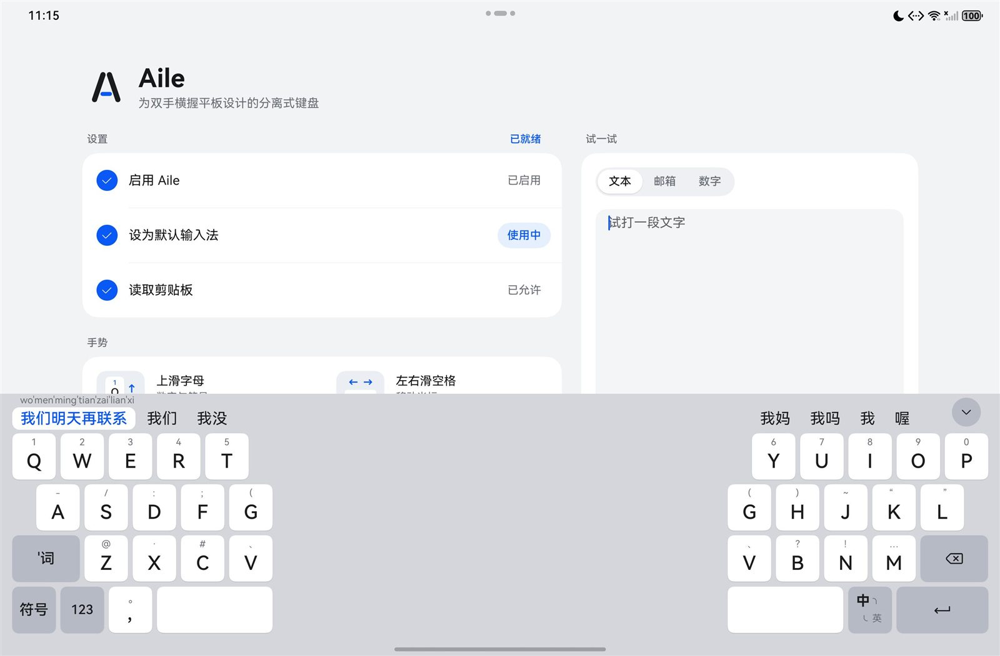
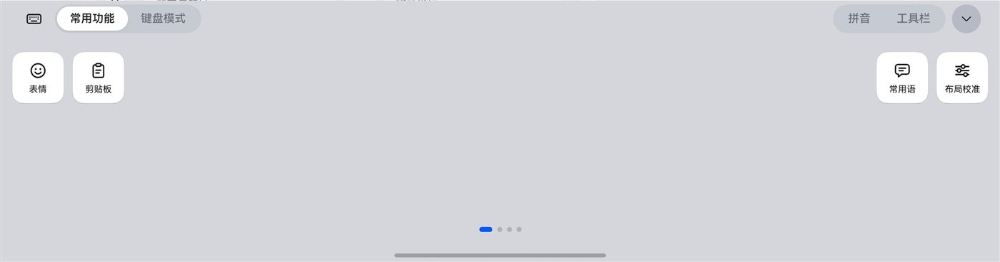
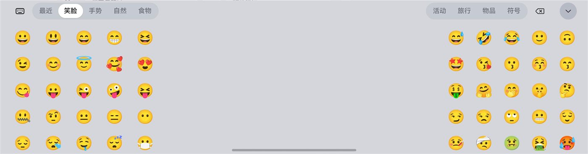
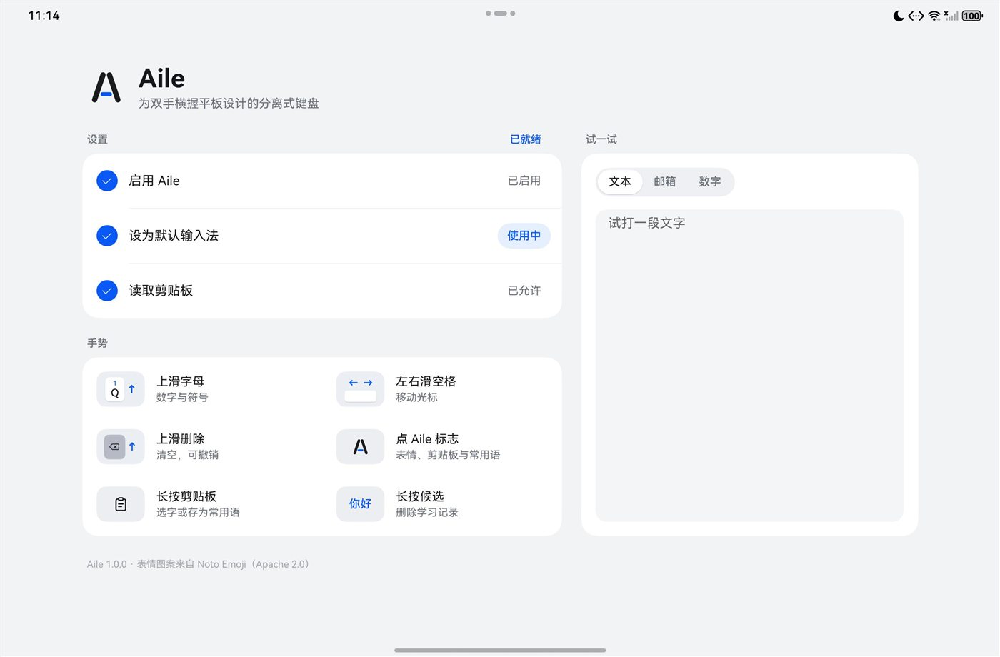
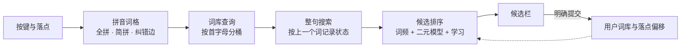

<p align="center">
  
</p>

<h1 align="center">Aile</h1>

<p align="center">
  <b>为双手横握平板设计的分离式 HarmonyOS 输入法</b><br>
  键盘分成左右两半，各自带有一个空格键。
</p>

<p align="center">
  
  
  
  
  
  <a href="LICENSE"></a>
  <a href="https://linux.do"></a>
</p>

<p align="center">
  <a href="#快速上手">快速上手</a> ·
  <a href="#界面一览">界面一览</a> ·
  <a href="#拼音引擎">拼音引擎</a> ·
  <a href="#评测数据">评测数据</a> ·
  <a href="鸿蒙平板输入法开发文档.md">开发文档</a>
</p>

<p align="center">
  
</p>

<p align="center"><sub>输入 womenmingtianzailianxi 时，首选候选为“我们明天再联系”。本页截图均来自模拟器，机型为 MatePad Pro 12。</sub></p>

---

## 为什么做 Aile

横握平板打字时，拇指很难够到屏幕底部正中的空格键。

Aile 把键盘拆成左右两块，并让两块各自带上空格、删除与回车等常用按键。双手握住平板以后，两只拇指都能直接完成打字、确认候选与删除。

在法语里，Aile 的意思是翅膀。图标里的 A 形向两侧分开，对应左右展开的两个键区。悬在中间的短横代表空格键，也就是两只拇指共用的那个位置。

## 功能亮点

- **双空格分离布局**：横屏时，键盘默认拆成左右两块，并在两侧各放一个空格键。中文组词期间，两个空格键都会确认首选候选。
- **整句拼音引擎**：引擎用带回退的二元语言模型为整句打分，并直接给出“我们明天再联系”这样的整句候选。
- **误触与打错纠正**：引擎会根据手指落点考虑相邻字母，并纠正字母打反与多打一个字母这两类打错。打反的两个字母分属两个音节时，引擎也能纠正回来。比如输入 `xiaznai` 时，首选候选就是“现在”。
- **现代聊天词库**：在 AOSP 词库之外，本项目合并了 jieba、THUOCL 与 phrase-pinyin-data 等开源词表，使词库达到 174542 条。词频按 1.3 亿词的 LCCC 聊天语料重新统计，更贴近日常聊天的用词习惯。
- **候选栏与更多候选**：左右滑动任意一侧的候选区，就能翻看后面的候选。点按右侧的展开按钮以后，候选会铺满键区并排成上下滚动的网格，左侧可按拼音音节筛选候选，顶部可切换“全部 / 词语 / 单字”。长按某个候选，可以把它固定在首位或者删除，删除以后还能撤销。
- **本机学习与简拼召回**：用户明确提交候选以后，引擎才会调高这些词的排序，并自动建立首字母简拼索引；常用 2 至 4 音节短句确认一次即可生效，例如打过“输入法”后再按 `srf`、打过“吗”后再按 `m` 即可快速召回。
- **落点偏移学习**：拇指斜着够向远处的按键时，落点往往偏向固定的一侧。键盘会记下每个字母键的偏移，并据此计算误触代价。
- **可调布局**：在布局校准界面里，用户可以拖动滑块调整键盘高度、键区宽度、边距与空格宽度。
- **表情、剪贴板与常用语**：点按顶部栏的 Aile 标志，就能打开这些面板。分离布局下，面板内容也按左右键区分开排列。
- **完全离线**：应用只申请读取剪贴板这一项权限，没有申请网络权限。

## 界面一览

### 整句与纠错

<p align="center"></p>

输入 `zhnogguo` 时，引擎纠正字母顺序后给出“中国”。右手区在 H 与 B 的左侧各补了一个 G 与 V，让右手食指不必跨过中央间隙。

### 功能面板

<p align="center"></p>

功能面板分为常用功能、键盘模式、拼音与工具栏四页，并把磁贴按左右键区分开摆放。模糊拼音的开关位于拼音页，默认处于关闭状态。

### 表情

<p align="center"></p>

在分离布局下，表情面板也拆成左右两块，并让两块内容一起上下滚动。面板用 Noto Emoji 的图片显示表情，并向输入框写入标准的 Unicode 字符。

### 布局校准

<p align="center"></p>

校准界面浮在两个键区之间，让用户拖动滑块时直接看到按键的变化。对于横屏与竖屏，键盘分别保存一套参数。

### 应用首页

<p align="center"></p>

应用首页实时显示设置进度，并提供手势速查与试打区。启用与设为默认两步各带一个按钮，可以直接跳到系统的输入法设置页。

## 手势速查

| 操作 | 效果 |
|---|---|
| 字母键上滑 | 输入键帽上方的数字或符号 |
| 逗号句号键上滑 | 中文状态输入句号，英文状态输入逗号 |
| 左右滑动空格键 | 移动光标，抬起手指后不输入内容 |
| 中文组词时按任一空格 | 确认首选候选 |
| 中文组词时按左下角的 `'词` 键 | 插入音节分隔符 |
| 删除键上滑 | 清空输入框；组词期间只清空拼音 |
| 顶部栏的“撤销清空” | 恢复清空前的全文与光标位置 |
| 左右滑动候选栏 | 翻到下一页或上一页候选 |
| 点按候选栏右侧的展开按钮 | 打开更多候选，左侧可按拼音音节筛选，顶部切换全部 / 词语 / 单字，右侧可以重输、删除或把字母原样上屏 |
| 长按候选 | 固定在首位或删除，删除以后可以撤销 |
| 点按顶部栏里刚复制的文字 | 直接上屏。点胶囊右端的关闭键只收起胶囊，不删除剪贴板历史 |
| 长按剪贴板卡片 | 选字、存为常用语或删除 |
| 单击或双击 ⇧ | 大写一次，或锁定大写。英文状态下，字母键平时显示小写，开启大写时显示大写 |

## 拼音引擎

引擎全部用 ArkTS 编写，并直接运行在输入法扩展的进程里。从按键到候选栏，整个流程如下。



<details>
<summary><b>拼音词格</b></summary>

<br>

引擎先把字母串切成一张词格，并用每条边表示一段拼音的一种读法。边分为完整音节、未打完的音节、简拼与分隔符四类，并各自带有对数域的代价。

整串能用完整音节切开时，切进音节内部的简拼边会多扣 3.0 分。因此，引擎会把 `hengping` 切分成 `heng'ping`，并给出“横屏”这个首选。

同样在整串能切开时，末尾没打完的音节如果切进了完整音节内部，引擎会多扣 4.5 分。因此，输入 `gun` 时的首选是“滚”。再打一个字母成为 `guni` 以后，“姑娘”就会回到首位。

对于 `sh`、`zh` 这类只有声母的输入，简拼照常生效。每条简拼边扣 2.2 分，并可以使用全部声母以及 a、e、o 作为首字母。

</details>

<details>
<summary><b>误触与打错纠正</b></summary>

<br>

手指落下时，键盘记下落点，并把附近的字母也当作可能的输入。每个候选字母的代价来自两个按键产生该落点的对数似然之差，另加 0.8 的先验。

除了误触，引擎还会加入相邻字母互换与多打一个字母两种纠正。这两种纠正的代价都是 5.5，略高于手指按在邻键正中时的误触代价。

有时，打反的两个字母分属两个音节。例如，把“现在”打成 `xiaznai` 时，n 与 z 跨过了音节的分界。两个大拇指分管左右两半键盘时，这种打反并不少见。

对于这种打反，引擎会生成一对纠错边。按照这对边，左半边读成换回字母以后的前一个音节。同时，右半边读成后一个音节。

由于右半边只能紧跟在左半边后面，两条边总是成对使用。两条边分属两个词语时，整句搜索也能把它们接起来。比如，`qingbhauiyi` 会纠成“请把会议”。

有些音节打反以后，正好是另一个读得通的音节。对于这种音节，引擎同样会换回打反的字母，并多扣 1 分。例如，按 `rugou` 时，首选就是“如果”。

对于漏打的字母，引擎不做纠正。打字时，用户很少在音节中间漏掉字母。想少按几个字母时，用户会直接打简拼，比如按 `srf` 就能打出“输入法”。

对于末尾没打完的音节，纠正结果必须带有韵母。有了这条限制，`bs`、`zhg` 这类简拼就不会被当成打错。每个词语最多纠正一个音节，以免把正常输入改得面目全非。

原文本身读得通时，候选栏优先照顾用户实际按的字母。这时，纠错得到的词语必须停在原文的音节边界上。切进某个音节中间的简拼读法，也会排到停在边界上的词语后面。

同一个词语还有原文读法时，候选栏只列出原文读法。选了某个词语以后，如果剩下的拼音连纠错也读不完，候选栏就不列这个词语。

对于落点附近的邻键，引擎的要求更严。手指按在自己的键中间时，纠成邻键得到的词语必须比同样长度的原文词语更可能。按在两键交界附近时，引擎照常按邻键纠正。

这样一来，正常打字时，候选栏前 8 位混进纠错词的比例从 25% 降到了 9%。

对于多打一个字母的纠正，引擎也加了类似的限制。一段拼音的最后一个字母能和后面的字母拼成音节开头时，引擎不会把它当成多打的字母。

例如，`youbuguan` 里的 g 属于后面的 guan。选了“又不”以后，输入框里会留下完整的 `guan`。

</details>

<details>
<summary><b>整句搜索与二元模型</b></summary>

<br>

整句搜索按“上一个词语”把状态分组，每组最多留 2 条不同文本的历史，每个位置最多带走 8 条：先让 6 组各出一条最好的，剩下的名额留给得分相近的第二条历史。同一个末词的同音分歧因此也能走到串尾，例如 `zaishuo` 的“在说”与“再说”都会列在候选里。每段拼音按词频保留 3 个最可能的词语；有二元模型时，同读音的其余写法再多留 2 条，先交给上下文重排，`shi` 的第 4 个同音词不会在打分之前就被截掉。

二元模型由 LCCC 聊天语料与本项目手写的语料统计而来，并采用绝对折扣与回退。对于语料里出现过的两个词语，引擎按条件概率计分。对于没有出现过的组合，引擎按前一个词的回退权重计分。

剪枝时，构建脚本按次数与概率差的乘积挑选搭配，最后保留约 34 万组。模型文件约 3.6 MB，并按前一个词排序。

输入法启动时只保存模型文本，并在查询时用二分查找定位前一个词。解析过的常用前词会一直留在缓存里，用于加快后续查询。

在给整句的第一个词语打分时，引擎会参考已经上屏的上文，并在上文为空时按一段话的开头计算。整句候选一共列出得分相差不到 2.5 的最多 3 条方案，并按文本去重：最好整句用到了纠错时，只再补一条原文的最好整句，免得打错时首屏全是纠错整句；最好整句由三个以上的词语组成时，末词不同的次好整句也会列出；末词相同的备选在只有两个词的短句里同样保留。

整句方案之后，最好的整句由两个以上的词语组成时，候选栏还会列出它的前半段。例如，输入 `womenmingtianjian` 时，“我们明天见”后面紧跟着“我们明天”。前半段只停在最好整句自己的音节边界上，并且必须是最好整句开头的一段。

整句与前半段之后，把拼音整串读完的词语排在最前。其余的词语与单字先按能不能停在可以安全断开的位置分层，再按得分加覆盖奖励排序：每多一个音节加五分，最多加到二十分，长词不会只靠长度一路往前提。同一个词有多种读法时只留最可靠的一条，全是完整音节的读法优先于只切到半路的简拼，例如 `nihaouu` 里的“你好”按 ni+hao 读，而不是消耗 nih 的那条；选了以后剩下的拼音连纠错也读不完的词排在能读完的词后面，整段都读不出来时仍保留能确认的开头与原文。因此，常用的短词可以排到生僻的长词前面，例如 `gggggg` 的“哥哥”排在“桂公公”前面。

连续按同一个声母三次以上时，引擎会把这串字母当作叠字处理。例如，连按五个 b 时，前几个候选依次是“别别别别别、宝宝宝宝宝、抱抱抱抱抱、不不不不不”。

对于每个字，引擎用词库里现成的叠词拼出叠字。例如，“宝宝宝宝宝”由两个“宝宝”与一个“宝”组成。引擎按连按三到六个字母时的得分之和，给各个字排出先后。因此，多按或少按一个字母时，首选也不会换成另一个字。

这串字母后面还有别的拼音时，整句搜索会把排在最前的叠字当作一个词。例如，输入 `hhhhhxsl` 会得到“哈哈哈哈哈笑死了”。

</details>

<details>
<summary><b>词库与加载</b></summary>

<br>

构建脚本合并了 AOSP PinyinIME、jieba、THUOCL 与 phrase-pinyin-data 的词表，并加入本项目整理的常用词。读音优先采用本项目整理的写法，其次采用人工校对过的 phrase-pinyin-data 与 AOSP 读音。对于各方都没有收录读音的词语，构建脚本用已知词语与单字的常用读音拼出读音。

混合词频时，LCCC 聊天语料的切词计数占六成。jieba、AOSP 与本项目手写语料依次占两成、一成与一成，用于补足书面语与旧词。

LCCC 在清洗时删掉了含有部分字词的整段对话，例如“微信、红包、操作、政府”。对于原文里一次都没出现、在其他来源里又不算少见的词语，构建脚本只按其他来源估计词频。二元模型也不会因为没见过这些词，就给它们扣分。

jieba 的单字频率混有不少乱码字，例如 UTF-8 文本按 GBK 读出来的“鍙、鏄、鐨”。为此，构建脚本让单字单独成词的概率不超过它在 LCCC 里出现总次数的三倍。LCCC 里一次也没出现的字，要看 AOSP 词频，才能分出被删掉的常用字与乱码字。

构建脚本按首字母给 174542 条词条预先分桶，并让索引各行按键排序。输入法启动时只保存词库文本，并在查询时用二分查找定位索引键。第一次查询某个桶时，引擎才解析其中的词条，并把读音相同的词条归为一组。

输入法分三步读取词库、二元模型与学习数据，并在每两步之间让出主线程。热启动时，模拟器上词库与二元模型的读取各需 20 到 80 毫秒。

</details>

<details>
<summary><b>学习与隐私边界</b></summary>

<br>

引擎只在用户明确提交候选时学习，并跳过标点、数字或切换页面引起的自动提交。由引擎拼出的 2 至 4 音节整句与用户分段选出的词组确认一次即可学成新词，更长的整句第一次确认先进入待定表、一个月之内再次确认后生效。

用户提交单字或多字词后，引擎会自动建立首字母简拼索引并记录最近使用顺序；输入简拼或单字母（例如打过“输入法”后再按 `srf`，或打过“吗”后再按 `m`）时，已学词字会优先召回。用简拼或分隔符打出多字词时，引擎同样会记下实际按的字母（每个词最多记住三种按法），例如用 `w'a'n` 打出过“我爱你”以后，直接按 `wan` 也会列出它。

键盘还会记录每个字母键的落点偏移，并在同一个按键确认满 20 次以后启用这项偏移。这项偏移只用于计算误触代价，不会改变按键的命中范围。分离布局与常规布局的偏移分开记录，并保存在 `touch_offsets.json` 里。

学习记录只保存在输入法扩展的沙箱里，并且不会离开这台设备。长按候选做出的固定与删除，也保存在用户词库的文件里。删除某个候选时，这个词的学习记录也会一起清掉。

</details>

<details>
<summary><b>性能</b></summary>

<br>

连续打字时，引擎会沿用边特征没有变化的词弧。在离线评测里输入 49 个字母的整句时，各起点的搜索次数合计由 1225 次减少到 399 次。

由于新词库的首字母前缀更密，引擎给每条音节组合设了扣分上限。累计扣分超过 10 时，引擎不再展开这条组合。在离线评测里，展开的组合数因此减少了六成。

在模拟器上输入“我今天晚上不回家吃饭”时，每次按键的耗时都不超过 25 毫秒。输入法刚启动后的前几次按键需要解析词库桶，耗时约为 25 到 60 毫秒。在离线评测里，每次按键的平均耗时由 1.8 毫秒降到 0.7 毫秒。

</details>

## 评测数据

引擎调参以 `tools/engine-bench` 的离线评测为依据，并让评测样本与词库、语料保持分开。词语样本共有 400 个常用词，分别按七种方式查询。整句样本共有 298 句日常用语，其中双数行的一半专门留作验证。

本版另外从 LCCC 留出 1% 的对话作为聊天评测集，并让这部分对话不参与任何统计。评测脚本从中抽取 2000 个聊天片段，并取出最常见的 400 个多字词。聊天评测集由 `build-chat-eval.mjs` 在本机生成，并不提交到仓库。

**整句与聊天**

| 指标 | 上一版 | 本版 |
|---|---:|---:|
| 聊天整句首位 | 46.0% | **67.5%** |
| 聊天整句字准确率 | 83.7% | **92.1%** |
| 聊天词语简拼首位 | 40.5% | **53.8%** |
| 聊天词语简拼前三 | 68.3% | **84.8%** |
| 手写整句首位 | 87.6% | **91.9%** |
| 手写整句验证半边首位 | 85.9% | **92.6%** |
| 手写整句字准确率 | 97.4% | **98.2%** |

**旧词语样本：目标词排在首位的比例**

| 查询方式 | 上一版 | 本版 | 本版前三 |
|---|---:|---:|---:|
| 全拼 | 99.5% | 96.8% | 100% |
| 简拼 | 52.3% | 35.5% | 76.5% |
| 误触，落在两键交界 | 99.0% | 92.5% | 100% |
| 误触，落在邻键正中 | 84.3% | 78.3% | 85.8% |
| 相邻字母互换 | 92.5% | 84.8% | 97.3% |
| 多打一个字母 | 95.0% | 83.5% | 99.0% |

旧词语样本取自 AOSP 词库最常用的 400 个词，其中包括“回复日期”“呵呵”这类早年论坛用语。按聊天语料的词频，yg、zd、zj 的首选分别变成了“应该”“真的”“最近”。在新的候选里，原来的目标词“一个”“知道”“自己”都排在第二位。

邻键纠错改严以后，落在邻键正中的误触排进前三的比例从 94.0% 降到了 85.8%。这种情况下，键盘相信手指实际按下的键。

词库扩大以后，打错的拼音串更容易读成另一个真实的词语，比如 `zhidaoo` 会读成“知道哦”。这类读法大多合理，并让各类打错的首位比例下降了约 10 到 15 个百分点。整串本身读得通时，打错纠正会多扣 1.5 分，避免把“附近哦”里的 o 当成多打的字母吞掉。

运行评测时，脚本会把引擎源码复制成 TypeScript，并用 DevEco 自带的 tsc 编译：

```powershell
powershell -ExecutionPolicy Bypass -File tools\engine-bench\run.ps1
```

对比其他版本时，可以用 `-EngineDir` 指向另一份引擎源码，并用 `-Lexicon` 与 `-Bigram` 指向另一份词库与二元模型。加上 `-NoBigram` 以后，评测会关闭二元模型。

## 快速上手

### 准备环境

- DevEco Studio，并安装 HarmonyOS 6.0.2（API 22）SDK
- 一台鸿蒙平板，或者一台 Tablet 模拟器
- 在真机上安装时，需要一个用于调试签名的华为账号

### 构建

用 DevEco Studio 打开工程并完成 Sync，然后构建 `entry` 模块即可。如果习惯命令行，也可以调用 DevEco 自带的 Node、ohpm 与 hvigor：

```powershell
$deveco = 'D:\HUAWEI\DevEco Studio'   # 改成本机的安装目录
$node = "$deveco\tools\node\node.exe"
$env:JAVA_HOME = "$deveco\jbr"
$env:DEVECO_SDK_HOME = "$deveco\sdk"

& $node "$deveco\tools\ohpm\bin\pm-cli.js" install
& $node "$deveco\tools\hvigor\bin\hvigorw.js" --mode module `
  -p product=default -p module=entry@default -p buildMode=debug assembleHap --no-daemon
```

构建产物位于 `entry/build/default/outputs/default/`，其中的 `entry-default-unsigned.hap` 可以直接安装到模拟器上。

> [!NOTE]
> 安装到真机时，需要使用签名以后的 `entry-default-signed.hap`。仓库里的 `build-profile.json5` 记录着作者本机的签名路径，并需要在换电脑以后重新配置。
>
> 重新配置时，请在 **File › Project Structure › Signing Configs** 里生成自动签名。签名证书与密钥需要在本机自行生成，并且不会进入版本库。

### 安装与启用

```powershell
$hdc = "$deveco\sdk\default\openharmony\toolchains\hdc.exe"
& $hdc list targets
$target = '换成 list targets 列出的设备标识'
& $hdc -t $target install -r entry\build\default\outputs\default\entry-default-signed.hap
```

1. 打开 Aile 应用，点按“启用 Aile”旁边的按钮，在系统的输入法页面里打开 Aile。
2. 回到应用首页，点按“设为默认输入法”旁边的按钮，把默认输入法换成 Aile。
3. 需要键盘收录复制过的文字时，在首页允许读取剪贴板。
4. 在首页右侧的试打区里点一下，就可以开始输入。

## 项目结构

```text
Aile/
├── AppScope/                      应用级配置与图标
├── entry/src/main/
│   ├── ets/
│   │   ├── engine/                拼音引擎：词格切分、整句搜索、词库、二元模型与用户词库
│   │   ├── ime/                   输入法控制：组词状态、提交、面板与剪贴板
│   │   ├── inputmethod/           InputMethodExtensionAbility 入口与键盘页面
│   │   ├── keyboard/              布局计算、触摸路由、误触纠正与落点学习
│   │   │   └── components/        键帽、候选栏、功能面板、表情、剪贴板与布局校准
│   │   ├── pages/                 应用首页：设置进度、手势速查与试打区
│   │   └── storage/               布局参数与用户词库的持久化
│   └── resources/rawfile/
│       ├── lexicon/               基础词库与二元模型，由脚本生成
│       └── emoji/                 Noto Emoji 图片
├── tools/
│   ├── fetch-lexicon-sources.mjs  下载外部词表与 LCCC 语料
│   ├── scan-lccc.mjs              拆分 LCCC 的训练与留出部分
│   ├── build-vocab.mjs            合并各来源的词表与读音
│   ├── count-lccc.mjs             切分语料，统计词频与相邻词语
│   ├── find-lccc-absent.mjs       找出语料清洗时过滤掉的词
│   ├── build-lexicon.mjs          生成基础词库
│   ├── build-bigram.mjs           生成二元模型
│   ├── lexicon-lib.mjs            构建脚本共用的读取与切词
│   ├── engine-bench/              引擎离线评测与回归测试
│   ├── candidate-rank/            候选排序与拼音筛选单测
│   ├── continuation-regress/      选词续接回归测试
│   ├── frontend-regress/          前端组词状态回归测试
│   └── lexicon-src/               词库原料：AOSP 原始词库、常用词与手写语料
├── promo/                         宣传视频与生成脚本
├── docs/images/                   README 截图
└── 鸿蒙平板输入法开发文档.md         开发文档与决策记录
```

## 扩充词库

常用词按主题放在 `tools/lexicon-src/aile-words` 下，并在每行写明一个词语与它的拼音：

```text
@5
微信 wei xin
朋友圈 peng you quan
```

文件里的 `@5` 到 `@1` 表示等级，依次对应 AOSP 词频尺度下的 30000、10000、3000、1000 与 300。对于词库里已有的词语，构建脚本取两者中较大的词频。

另外，`@set N` 可以强制指定之后词语的词频。如果要删除词库里的旧写法，请把这些词语写在 `@remove` 之后。

修改常用词或手写语料以后，请按顺序运行下面的脚本。第一次运行之前，脚本需要下载约 390 MB 的外部数据。后面几步在普通电脑上共需十分钟左右，并会占用 3 GB 左右的内存。

```powershell
& $node tools\fetch-lexicon-sources.mjs
& $node --max-old-space-size=3000 tools\scan-lccc.mjs
& $node --max-old-space-size=3000 tools\build-vocab.mjs
& $node --max-old-space-size=3200 tools\count-lccc.mjs
& $node --max-old-space-size=3000 tools\find-lccc-absent.mjs
& $node --max-old-space-size=3000 tools\build-lexicon.mjs
& $node --max-old-space-size=3200 tools\build-bigram.mjs
& $node tools\engine-bench\build-chat-eval.mjs
```

外部数据都采用 MIT 许可，下载后存放在 `tools/lexicon-src/external`，并不提交到仓库。新增词语以后，请从 `build-vocab.mjs` 开始依次运行。只调整已有词语的词频时，可以只运行最后三步。

`count-lccc.mjs` 会检查手写语料是否整句包含评测句子，发现重合时会列出这些句子。为了保证评测结果可信，请先改写这些语料，再重新生成二元模型。

> [!IMPORTANT]
> 由于词库索引按 UTF-16 码元记录偏移，词库文件必须保持 LF 换行。在 Windows 上开启 `core.autocrlf` 时，仓库里的 `.gitattributes` 会让这些文件保持 LF 换行。

## 隐私

- 所有输入都只在本机处理，并不经过任何网络请求。
- 日志只记录拼音长度与耗时，不会写入输入的内容。
- 学习数据只保存在输入法扩展的沙箱里，并随应用一起卸载。
- 用户授予读取权限以后，键盘才会收录剪贴板。未授权时，键盘只能通过系统的粘贴控件读取一次。
- 密码框由系统安全键盘接管，不会交给 Aile 处理。

## 已知限制

- 目前，Aile 只提供全拼这一种输入方案。按照开发文档的规划，双拼、词库导入与更多机型适配属于后续版本。
- 简拼的首位比例约为 52%，已经接近同组首字母本身决定的上限。
- 真机上的按键耗时尚待实测，并可以通过 hilog 里的 `compose slow` 日志读取。

## 开发文档

关于完整的设计决策、平台核实记录与验收方法，请阅读 [鸿蒙平板输入法开发文档](鸿蒙平板输入法开发文档.md)。其中，D01 到 D43 的决策表记录了每项功能的取舍原因。

## 友情链接

- [LINUX DO](https://linux.do)：感谢这个社区，让 Aile 有机会第一次公开分享。

## 致谢与许可

- 基础词库的一部分来自 [AOSP PinyinIME](https://android.googlesource.com/platform/packages/inputmethods/PinyinIME/)，并按 Apache-2.0 许可使用。许可声明保存在 `tools/lexicon-src/NOTICE-AOSP-PinyinIME.txt` 里，并随原始词库一起提交。
- 生成词库时，构建脚本还用到了 [jieba](https://github.com/fxsjy/jieba)、[THUOCL](https://github.com/thunlp/THUOCL)、[phrase-pinyin-data](https://github.com/mozillazg/phrase-pinyin-data)、[pinyin-data](https://github.com/mozillazg/pinyin-data) 与 [LCCC](https://github.com/thu-coai/CDial-GPT) 对话语料。这些数据都按 MIT 许可使用，并只在生成词库时下载到本机。各自的版权声明汇总在 `tools/lexicon-src/NOTICE-lexicon-sources.txt` 里，并随词库一起打包进应用。
- 表情图片来自 [Noto Emoji](https://github.com/googlefonts/noto-emoji)，并按 Apache-2.0 许可使用。许可文件与图片放在同一个目录里，也就是 `entry/src/main/resources/rawfile/emoji/`。
- 常用词、手写语料与手写评测句子均由本项目自行编写，并按本项目的 MIT 许可证发布。

本项目自身的代码按 MIT 许可证开源，全文见 [LICENSE](LICENSE)。
